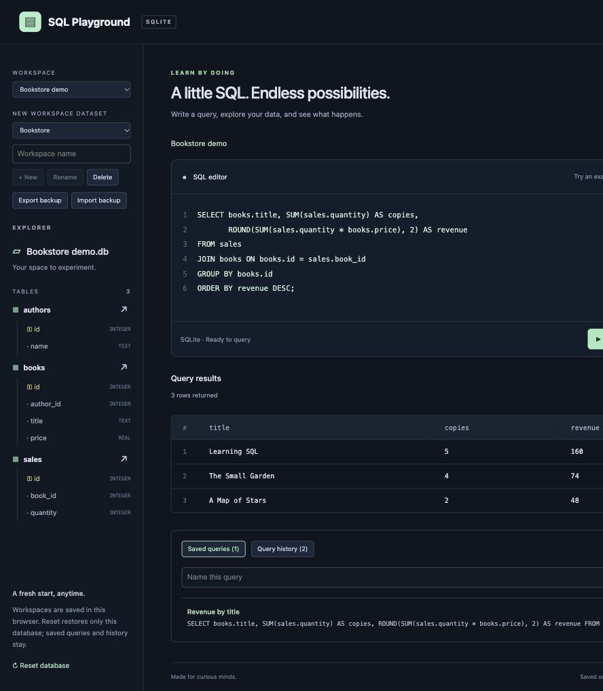
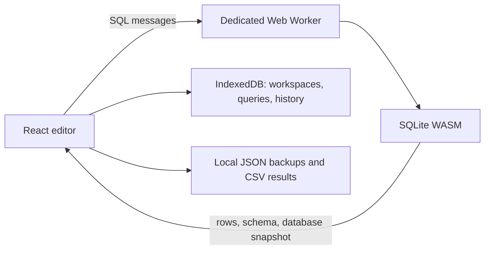

# SQL Playground

A small, complete SQLite learning app. Write real SQL, explore tables, inspect
results, and keep independent workspaces without installing a database server.

Built with **React 19**, **Vite**, **sql.js / SQLite WebAssembly**, **Web Workers**,
and **IndexedDB**. The original Python SQLite engine is included as a separate CLI.

[Hosted app](https://evison-sql-playground.tastypiano.chatgpt.site) ·
[Architecture and schemas](docs/architecture.md) ·
[Deployment](docs/deployment.md) · [Release checks](docs/testing.md)

The hosted app is owner-private by default. Local development needs no account.



## Start in two commands

Install Node.js **22.12+** (CI uses Node 22), then run from the repository root:

```sh
npm run setup
npm run dev
```

Open the local URL printed by Vite. Click **Run query** or press **Cmd/Ctrl+Enter**.

```sql
SELECT users.username, posts.caption
FROM posts
JOIN users ON users.id = posts.user_id;
```

## What you can do

- Execute SELECT, joins, aggregates, CREATE, INSERT, UPDATE, DELETE, and batches.
- Inspect result tables, column headings, NULL values, affected-row counts,
  execution time, and inline SQL errors. Export the displayed result as CSV.
- Explore table names, columns, types, and primary keys. Preview any table.
- Create, rename, switch, and delete isolated workspaces. Choose Mini Instagram,
  Bookstore, or an empty database when creating one.
- Keep editor drafts, database edits, named queries, and the latest 100 query
  attempts per workspace. Click saved queries or history entries to load them.
- Download a JSON workspace backup and import it as a separate workspace.
  Backups include database contents, editor SQL, saved queries, and history.

Use **Reset database** to restore a workspace's original dataset while retaining
its query library and history. Use **Reopen saved database** after a timeout to
recover its last completed snapshot. The final workspace cannot be deleted.

## Sample datasets

| Dataset | Tables | Practice |
| --- | --- | --- |
| Mini Instagram | `users`, `posts`, `comments` | SELECT, foreign keys, joins, post counts |
| Bookstore | `authors`, `books`, `sales` | Prices, grouping, sales and revenue |
| Empty database | None initially | Create your own schema |

Examples in the editor change with the workspace's dataset. Reset always uses
the dataset chosen at creation, including after importing a backup.

## How it works



Playground SQL only sees that workspace's SQLite database. Application metadata
lives in IndexedDB, outside the SQL engine. No SQL, database contents, saved queries,
or history is sent to a backend. Dependencies and WASM are bundled; there are no
external font or runtime CDN requests. Hosting may require its own sign-in.

A browser lock permits one editing tab per origin to prevent snapshot overwrites.
A second tab asks you to close the first and reopen. Browser storage belongs to the
current origin/device; use backups to move workspaces between browsers or deployments.

## Verify and build

```sh
npm test
python3 -m unittest discover -s tests -v
npm run build
npm run preview
```

The build creates `web/dist/` for local preview and `dist/` for deployment. Both are
ignored by Git. GitHub Actions runs web tests/builds and Python tests on 3.9, 3.12,
and 3.13, and uploads the production app as a build artifact.

## Python engine (Phase 1)

Python 3.9+; no third-party packages required:

```sh
python3 main.py --init
python3 main.py --query 'SELECT * FROM employees WHERE salary > ?' --params '[80000]'
python3 main.py --query 'SELECT * FROM missing_table'
```

The CLI creates `sample.db` with four employees. `--init` is repeatable and preserves
existing rows. `--database :memory:` selects an ephemeral database. Output is JSON
with `success`, `columns`, `rows`, `row_count`, `affected_rows`, and `error`; exit
codes are 0 on success and 1 on failure. It accepts one statement per call, commits
successes, and rolls back SQL failures. BLOB values use a hex object in CLI JSON.
This database is independent of browser workspaces.

```python
from engine import SQLiteEngine

with SQLiteEngine(':memory:') as engine:
    engine.create_sample_database()
    result = engine.execute('SELECT name FROM employees WHERE department = ?', ['Engineering'])
    print(result.to_dict())
```

## Limits and behavior

- Browser queries run in a worker with a **5-second** timeout. After timeout,
  reopen the workspace to recover its last completed snapshot. Timeouts are not a
  hard memory quota; very large queries can still exhaust browser resources.
- At most **500 rows per statement** are displayed/exported as CSV. CSV is raw
  data: NULL and empty strings both export as empty cells.
- Earlier committed statements in a batch remain applied if a later statement
  fails. Complete transactions within one Run (`BEGIN; … COMMIT;`). Unfinished
  transactions are explicitly rolled back and reported as errors before snapshotting.
- Snapshot persistence covers the main SQLite database, not attached databases or
  temporary tables. The worker restores foreign-key enforcement after each export.
- Drafts save after a 300 ms pause. Switching flushes the draft first. Writes that
  fail (including quota errors) show **Not saved**, a visible error, and **Retry save**.
  Closing before a pending save finishes can still lose changes.
- Browsers must support IndexedDB, WebAssembly, Workers, Web Locks, and secure
  contexts (HTTPS or localhost). Clearing site data removes workspaces. Private
  browsing can limit storage. JSON imports are capped at **20 MB**.
- This release intentionally has no accounts, cloud synchronization, public SQL
  backend, or collaboration. It is the complete single-user portfolio MVP from
  the four-phase plan.

## Project layout

```text
engine.py, main.py       Python SQLite engine and CLI
web/src/main.jsx        React UI and workspace lifecycle
web/src/database.js     SQL execution and schema inspection
web/src/session.js      Worker protocol, datasets and snapshot handling
web/src/worker.js        Web Worker bootstrap and WASM loading
web/src/storage.js       IndexedDB persistence
web/src/backup.js        Workspace backup validation and CSV conversion
web/src/datasets.js      Sample schemas and example queries
web/src/*.test.js        Web engine, persistence and release tests
tests/                  Python engine and CLI tests
docs/                   Architecture, deployment and verification
.openai/hosting.json    Hosted Site identity and static output
```
