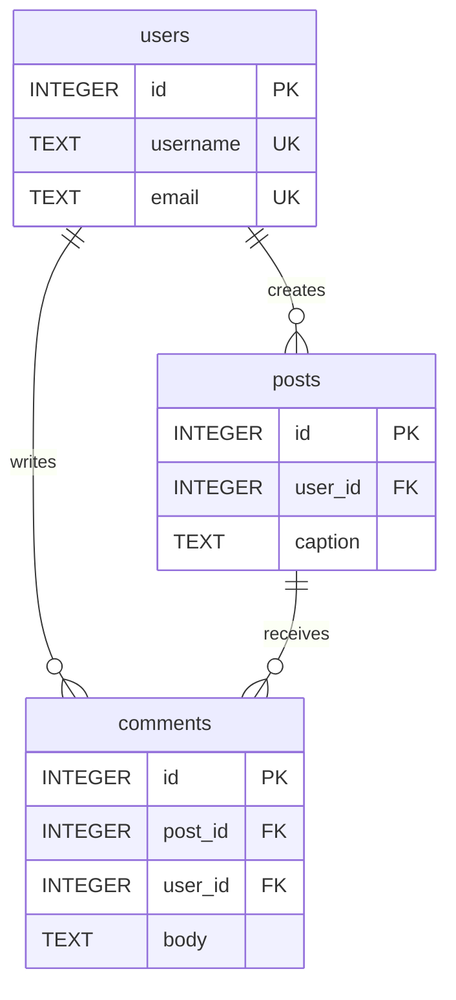
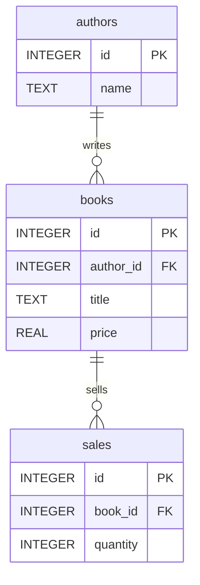

# Architecture and database schemas

The browser app and Python CLI are two independent implementations. The browser
uses sql.js because a local WebAssembly database avoids exposing a server that
accepts arbitrary SQL. React sends SQL to one dedicated worker, which executes it,
returns typed values and schema information, and exports the main database snapshot.
The UI stores the snapshot with workspace metadata in IndexedDB.

## Playground schemas

All non-key text fields are NOT NULL. Username and email are unique. Seeds contain
four users, three posts, and three comments. Foreign keys are enabled.

Bookstore seeds contain three authors, four books, and four sales. Prices must be
nonnegative and quantities positive. Empty workspaces start with foreign keys on
and no application-created tables. Exact DDL and examples live in `web/src/datasets.js`.

The Python CLI seeds `employees(id INTEGER PRIMARY KEY, name TEXT NOT NULL,
department TEXT NOT NULL, salary INTEGER NOT NULL CHECK(salary >= 0))`.

## Application storage

IndexedDB database `sql-playground`, version 1, has one `workspaces` object store
keyed by `id`. It is unrelated to the `users` table in the playground dataset.

| Workspace field | Value |
| --- | --- |
| `id` | UUID, primary key |
| `name` | Display name |
| `dataset` | `instagram`, `bookstore`, or `blank`; old records default to Instagram |
| `sql` | Editor draft |
| `bytes` | Uint8Array main-database snapshot, or null before initialization |
| `saved` | Array of `{id, name, sql}` |
| `history` | Latest 100 `{id, sql, at, error, elapsed}` attempts |
| `updatedAt` | Last editor/query update timestamp in milliseconds |

There is no registration or application `users` table in this MVP. If a future
cloud service introduces accounts, its users, workspaces, saved queries, and history
must live in a separate application database. Never execute playground SQL there.

## Lifecycle and failure handling

1. Acquire the origin-wide Web Lock. Other editing tabs are blocked.
2. Open IndexedDB and select an existing workspace or seed the first one.
3. Initialize the worker from saved bytes or the workspace's selected dataset.
4. Execute SQL, finalize statements, resolve any open transaction, and export bytes.
5. Persist the snapshot and history before enabling the next query.
6. Flush pending editor text before workspace switching/creation/import.
7. On timeout, terminate the worker and record the failed attempt. Reopening starts
   from the last completed in-memory snapshot; successful persistence survives reload.

A SQL error does not poison the worker. Foreign keys are re-enabled after snapshot
export because sql.js closes/reopens its connection. A complete explicit transaction
works within one batch; an unfinished transaction is rolled back with a visible error.
App data and SQL snapshots remain separated even if SQL drops every playground table.

Backups have a format marker and version, validate their fields and SQLite header,
and receive fresh IDs on import. A malformed SQLite file may still fail SQLite's own
validation at initialization; the user can reset or delete that imported workspace.
